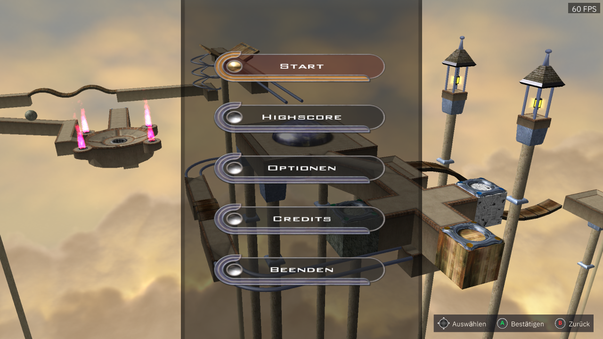
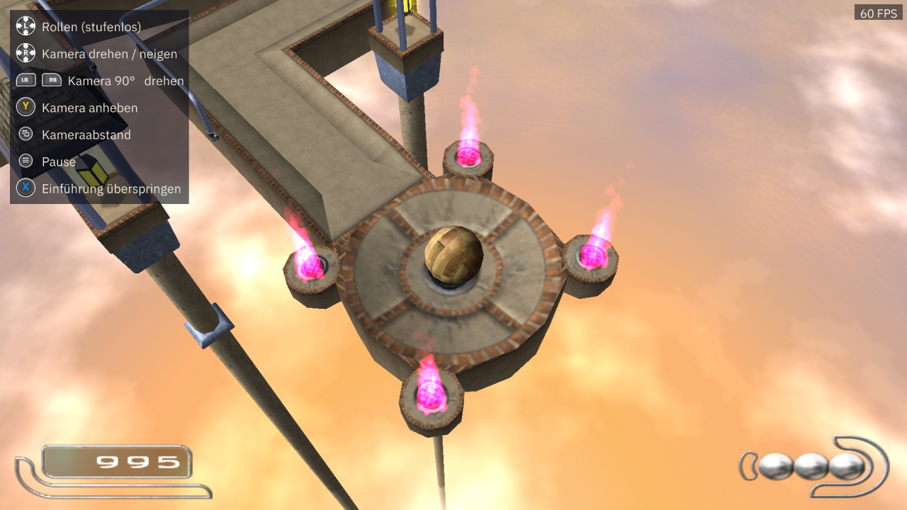
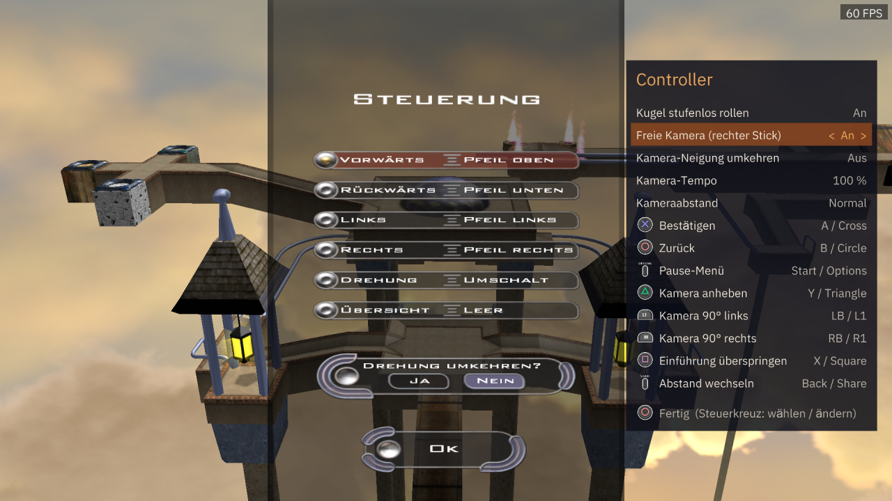

# Ballance – HD Patch & Launcher

Unofficial HD patch with its own launcher for **Ballance** (GOG / Steam) on Windows 10/11. One setup, and the game runs borderless at your monitor's native resolution in real widescreen, with even VSync frames and full Xbox / PlayStation controller support – stepless rolling, a free third-person camera and button prompts in the game. Uninstalling restores the game folder byte for byte.

Inoffizieller HD-Patch mit Launcher für Ballance (GOG / Steam) – deutsche Kurzfassung unten.



## What it does

| Area | Solution |
|---|---|
| Game executable | [BallancePlayer](https://github.com/doyaGu/BallancePlayer) by doyaGu replaces `Bin\Player.exe`: 32-bit colour, any resolution, borderless fullscreen, no registry, no Windows 98 compatibility mode |
| Game plugin | `Managers\BallanceHD.dll` – a native Virtools manager plugin loaded by the engine itself; no mod loader, no Visual C++ runtime |
| Widescreen | Hor+ field of view: the 4:3 cameras get the screen's aspect ratio just for rendering, nothing is cut off at the top or bottom |
| Frame rate | VSync at the display's refresh rate – an even 16.67 ms per frame at 60 Hz (a 60 fps limiter gives 17.3 ms frames and micro-stutter). The game runs at the same speed at any frame rate |
| Graphics | 32-bit textures instead of 16-bit, anti-aliasing up to 8x MSAA |
| Controller | Xbox controllers (XInput) and PlayStation controllers (DualShock 4, DualSense – read directly over USB or Bluetooth, no Steam or DS4Windows). Works also when the game is started directly (GOG Galaxy) |
| Rolling | the left stick rolls the ball steplessly: the game's own force, in any direction, scaled by the tilt |
| Camera | the right stick turns and tilts the camera freely around the ball at a fixed distance; View / Share steps through four distances; LB / RB keep the game's 90° turns |
| Prompts | Xbox or PlayStation button glyphs in menus and the pause menu, a controls legend at level start; both fade out after 10 seconds |
| Settings in the game | Options → Controls gets a controller panel (Y to edit): stepless rolling, free camera, invert tilt, camera speed and distance, button layout |
| Fixes | no "install DirectPlay?" prompt (empty `dpnhpast.dll`); GOG's dgVoodoo 2.79, which draws menus and sky black with the new player, is disabled (backed up) |
| Launcher | graphics, controller, button layout, game language; fully usable with a controller (console-style rows, glyph hints); English or German (follows Windows) |



## Installation

1. Download `BallanceHD_Patch_<version>.zip` from [Releases](../../releases), unzip it and run `BallanceHD_Setup.exe`. It finds the game (GOG / Steam registry, desktop shortcut) and checks the game files. No administrator rights, no extra runtimes.
2. Play via **"Ballance - HD Launcher"** (recommended – graphics and language are set there). Started directly from GOG Galaxy the game still runs in HD with the controller, using the settings last saved in the launcher.
3. Uninstall via Windows "Apps & Features", the start menu or the launcher's About page – every original file comes back; save games and high scores (`Database.tdb`) are never touched.

An update from 1.x keeps settings and button layout and removes the old BML+ mod loader.

## Controller layout (Xbox / PlayStation)

| Button | Action | Button | Action |
|---|---|---|---|
| Left stick | roll the ball (stepless), menus | LB / L1, RB / R1 | turn camera 90° |
| D-pad | menus, roll like the arrow keys | Y / Triangle | raise camera (hold) |
| Right stick | turn and tilt the camera | View / Share | camera distance |
| A / Cross | confirm | Start / Options | pause menu |
| B / Circle | back | X / Square | skip tutorial |

Every action can be remapped in the launcher or in the game (Options → Controls → Y).



## Building

Requirements (all portable, in `Werkzeuge\` – not part of the repository):

- [llvm-mingw](https://github.com/mstorsjo/llvm-mingw) (clang + lld) – the plugin is compiled for the Microsoft C++ ABI (`i686-pc-windows-msvc`) without the Visual C++ runtime
- [Virtools SDK 2.1](https://github.com/doyaGu/Virtools-SDK-2.1) (reconstructed headers and import libraries; non-commercial use) in `Werkzeuge\Virtools-SDK-2.1-main`
- .NET Framework 4.x `csc.exe` (part of Windows) for launcher and setup (C# 5)

```powershell
powershell -ExecutionPolicy Bypass -File build.ps1
```

Output: `out\BallanceHD_Setup.exe` (everything embedded) and `out\release\BallanceHD_Patch_<version>.zip`. The version lives in `src\common\Text.cs` (`Version.Text`), `src\plugin\win.c` and `src\plugin\BallanceHD.cpp`.

Setup switches: `/install /silent /dir="<game folder>"`, `/uninstall /silent`. Launcher: `/snapshot=<folder>`, `/play`, `/lang=en|de`. Plugin: `BallanceHD\Settings.ini` → `[Debug] Trace=1` logs frame times, ball position and game state to `BallanceHD\plugin.log`; `BALLANCEHD_FAKEPAD=<file>` replaces the controllers for tests (`tools\test\FakePad.cs`).

## Layout

```
src/plugin/     BallanceHD.dll – widescreen, frame rate, controller, rolling, camera, prompts, in-game panel
                win.c / win.h – Windows side in plain C (XInput, DualShock 4 / DualSense HID, keys, files)
                Draw.cpp – 2D drawing on the Virtools render context
src/common/     shared by launcher and setup: game detection, settings, controller, texts (DE/EN), theme
src/launcher/   BallanceHDLauncher.exe
src/setup/      BallanceHD_Setup.exe – install, update, uninstall; renders the in-game font from Segoe UI
payload/        third-party archives (BallancePlayer, button glyphs) – checked by SHA256 at build time
tools/          plugin build, DLL stub, test helpers (simulated pad, keys, screenshots)
docs/           screenshots, glyph licence
```

Game files are not part of the repository.

## Technical notes

- **Widescreen**: in `OnPreRender` the attached camera gets the screen aspect and `fov' = 2·atan(tan(fov/2)·screen/4:3)`, then `ForceCameraSettingsUpdate` + `PrepareCameras`; `OnPostRender` restores the camera, so the game's scripts never see a change.
- **Rolling**: the game rolls the ball with four `SetPhysicsForce` blocks in the script "Ball Navigation". The plugin keeps its own instance of that building block (layout mirrored from the game's block, the prototype alone has none) plus its own `Physics WakeUp` – the physics engine lets a slow ball sleep and ignores forces on it. Forces are only set while the game's ball navigation is active (not while the ball spawns).
- **Camera**: the right stick rotates `Cam_OrientRef` and `Cam_Orient` together (the game's 90° turns keep working), `Cam_Pos` is placed on a fixed distance and elevation, `InGameCam` exactly on it – no trailing, no spring-back.
- **Menus**: the controller is turned into the game's keys (`SendInput` scan codes); 90° turns are Shift + arrow taps.

## Credits

- **BallancePlayer** – doyaGu (MIT)
- **Virtools SDK 2.1 reconstruction** – doyaGu (build only)
- **Button glyphs** – UI Elements by Mikkel Julian "Arks" Petersen ([arks.itch.io](https://arks.itch.io)), CC BY 4.0
- Ballance © 2004 Cyparade / Atari, today Ziggurat Interactive. Unofficial fan project; it contains no game files.

Presented by CompiWare · Made by BockwurstWilly using Claude · Licence: [PolyForm Noncommercial 1.0.0](LICENSE)

---

## Deutsch (Kurzfassung)

Inoffizieller HD-Patch mit Launcher für **Ballance** (GOG / Steam) unter Windows 10/11: randloses Vollbild in nativer Auflösung, echtes Breitbild ohne Ränder, gleichmäßige Bilder mit VSync und volle Unterstützung für Xbox- und PlayStation-Controller – Kugel stufenlos rollen, freie Kamera, Tastensymbole im Spiel und Controller-Einstellungen unter Optionen → Steuerung.

**Installation:** `BallanceHD_Patch_<Version>.zip` unter [Releases](../../releases) laden, entpacken, `BallanceHD_Setup.exe` starten. Danach am besten über **„Ballance - HD Launcher“** spielen. Deinstallation über „Apps & Features“ – alle Originaldateien kommen zurück, Spielstände bleiben erhalten.

Ausführliche Spieler-Anleitung (Deutsch und Englisch): [README.txt](README.txt) – liegt auch dem Download bei.
